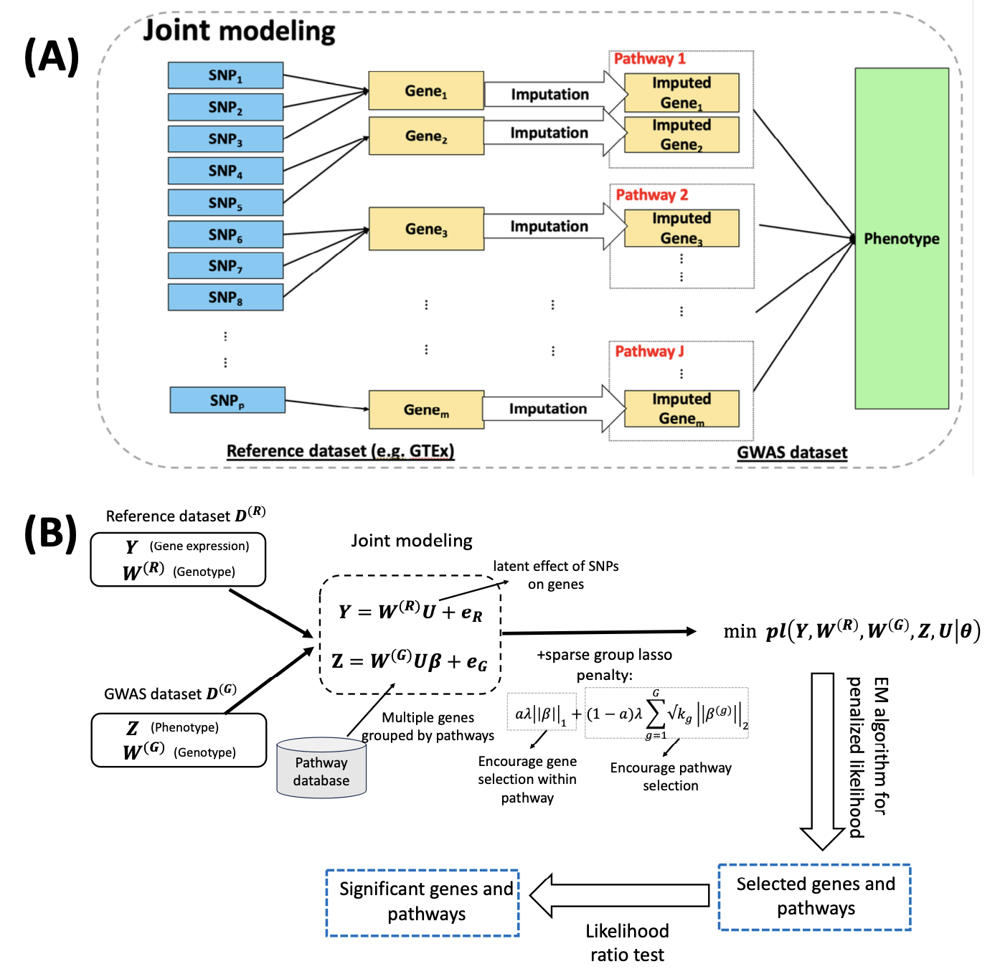

TIPS
===
TIPS package implements a novel multivariate TWAS method that Incorporates Pathway or gene Set information, namely TIPS, and utilized a sparse group lasso penalty to select the most important genes and pathways that contribute to a polygenic trait. Unlike existing univariate TWAS methods that perform association analysis for one gene at a time, TIPS examines multiple genes potentially grouped in biological pathways concurrently, capturing their collective impact on the trait. Such a multivariate pathway guided approach is essential for a comprehensive understanding of the genetic architecture of a complex polygenic trait and revealing the biological processes underlying the trait.



## R Code Overview

The `data_simulation.R` script simulates gene expression and SNP data for various experimental conditions. It provides flexibility in setting noise levels, group sizes, and effect sizes.

Installation
===
To install the TIPS package, you will first need to install devtools package and then execute the following code:
```
#install.packages("devtools")
library(devtools)
install_github("nwang123/TIPS")
```
Usage
===========
The following help page will also provide quick references for TIPS package and the example command lines:
```
library(TIPS)
```


Output 
===========
The main output of our tool is a list of pathways and genes with p-values from likelihood ratio test for their association with the phenotype of interest. These findings could offer more reliable and interpretable results for TWAS analyses. 

Development
===========
This R package is developed by Neng Wang.
